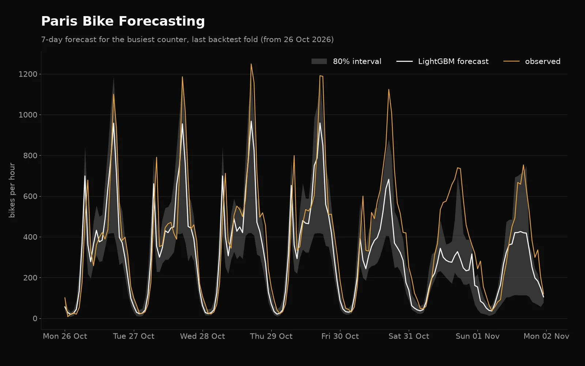

# Paris bike forecast

Hourly forecasts of bike traffic at the City of Paris permanent bike counters, evaluated with
rolling-origin backtests against seasonal-naive baselines, with quantile intervals and drift
monitoring.

This is my own rewrite of a bike-demand forecasting project I did as coursework. The original
course repo lives under a classmate's account and nothing here is copied from it: the data
source, pipeline, models and evaluation were rebuilt from scratch.


Work in progress. Results are added phase by phase.

## Results



<!-- BACKTEST:START -->
| Fold | Week from | Counters | Seasonal naive MAE | 4-week average MAE | LightGBM MAE | LightGBM 80% coverage | Interval width |
| --- | --- | --- | --- | --- | --- | --- | --- |
| 1 | 2026-09-07 | 95 | 16.73 | 41.52 | 16.65 | 82% | 70.6 |
| 2 | 2026-09-14 | 95 | 14.76 | 30.89 | 14.51 | 86% | 68.4 |
| 3 | 2026-09-21 | 95 | 17.94 | 20.22 | 20.43 | 84% | 70.0 |
| 4 | 2026-09-28 | 95 | 22.37 | 17.45 | 23.99 | 83% | 77.0 |
| 5 | 2026-10-05 | 95 | 20.47 | 18.63 | 16.11 | 89% | 76.0 |
| 6 | 2026-10-12 | 95 | 20.69 | 18.77 | 16.57 | 81% | 54.1 |
| 7 | 2026-10-19 | 95 | 35.65 | 38.10 | 19.29 | 73% | 54.4 |
| 8 | 2026-10-26 | 94 | 36.43 | 37.93 | 26.66 | 57% | 54.5 |
| **All folds** |  |  | **22.96** | **28.06** | **19.16** | **79%** | **65.6** |

8 rolling-origin folds, each trained on every hour before its cutoff and scored on the next 168 hours. Data snapshot 2024-01-01 to 2026-11-05, 95 counters. Scores pool every counter-hour with a known count.
<!-- BACKTEST:END -->

<!-- OVERALL:START -->
| Model | MAE | RMSE | sMAPE % | MAE vs seasonal naive |
| --- | --- | --- | --- | --- |
| Seasonal naive (same hour last week) | 22.96 | 46.27 | 34.4 |  |
| Seasonal naive, 4-week average | 28.06 | 55.62 | 35.6 | +22.2% |
| LightGBM (median) | 19.16 | 38.42 | 30.0 | -16.5% |
<!-- OVERALL:END -->

<!-- CHAMPION:START -->
Last training run: model version 3, backtest MAE 19.16, promoted to champion (beats the champion). Previous champion: version 1, MAE 19.80.
<!-- CHAMPION:END -->

The LightGBM interval holds close to its 80% target in ordinary weeks. It still falls short in the
second Toussaint school-holiday week (see Limitations).

## Architecture

```
opendata.paris.fr ─┐                                                    ┌─> FastAPI /forecast
Open-Meteo ────────┼─> Airflow ingest DAGs ─> Great Expectations ─> Postgres
calendrier / école ┘                                                │   └─> Grafana (data quality,
                                                                    │        model monitoring, alerts)
        snapshot ─> backtest ─> MLflow (runs, registry, champion) ──┤
                                                                    │
        forecast_weekly DAG: champion -> forecasts table ───────────┤
        score_daily DAG: forecasts vs counts -> scores, PSI drift ──┘
```

- `counters_backfill` (manual): yearly history files, then the live dataset, then the gap report.
- `counters_daily`: the last days from the live dataset, then the gap report.
- `weather_hourly`: one-off archive backfill, a daily archive refresh, and the latest hours.
- `holidays_yearly`: public holidays for metropolitan France.

Each load is validated before it is written: no negative or missing counts, no duplicate
counter-hour, timestamps on the hour, weather values in physical ranges. Results land in the
`dq_results` table and on the Grafana "Data quality" dashboard.

## How it's evaluated

- `forecast/snapshot.py` freezes the clean counts, weather and holidays from Postgres into
  parquet files and records their range and a content hash in `results/snapshot.json`, so a rerun
  scores exactly the same data.
- `forecast/backtest.py` runs a rolling-origin backtest: weekly cutoffs on Mondays, each fold
  trains on all data before its cutoff and forecasts the next week hour by hour.
- Metrics are MAE, RMSE and sMAPE. Plain MAPE is undefined here because counts hit zero at night;
  sMAPE counts an hour where both the actual and the forecast are zero as a perfect hour.
- Missing hours in the training history are filled from the same hour of an earlier week, so the
  weekly season never shifts. Missing actuals are not scored.
- `tests/test_leakage.py` checks every model: a forecast made at a cutoff must not change when all
  data after the cutoff is deleted, counts and issued weather forecasts alike.

## The model

One LightGBM model for all counters (`forecast/lgbm.py`), trained on one example per Monday in
the history: features are built as of that Monday and the targets are the following week's hours.
Three quantile models (0.1, 0.5, 0.9) give the median forecast and an 80% interval.

Every feature is known at the forecast cutoff (`forecast/features.py`):

- counts: the same hour one week earlier, the same hour on the last day before the cutoff, the mean
  of the same hour over the last four weeks, and the means of the last day and the last week;
- calendar in Paris local time: hour, day of week, month, public holiday, day before and after,
  and Paris school holidays (the national school calendar, published years ahead);
- weather **forecasts as they were issued** before the cutoff (Open-Meteo Previous Runs API, one to
  seven days ahead), never the weather that was later observed;
- the counter id.

`forecast/train.py` logs each run to MLflow (parameters, per-fold and overall metrics, the backtest
file), fits the final model on the whole snapshot, registers it, and moves the `champion` alias only
when the new version beats the current champion's backtest MAE on the same snapshot.

## Serving and monitoring

The model was trained and backtested as a weekly forecast made on Monday at 00:00 UTC for the next
168 hours, so that is how it is served:

- `forecast_weekly` (Mondays, after the morning data load) loads the MLflow `champion`, builds the
  features for that Monday from Postgres with the weather forecast available at that moment, and
  writes the 0.1 / 0.5 / 0.9 quantiles for every counter and hour of the week to `forecasts`.
  It refuses a week the champion was trained on, so a model is never scored on its own training
  data.
- The API (`api/main.py`) reads that table: `GET /forecast/{counter_id}?hours=24` returns the next
  hours from now with the interval, the model version and when it was issued.
- `score_daily` scores every day with known counts: MAE and 80% coverage per source and model
  version go to `forecast_scores`. It also computes PSI for the model's inputs (hourly counts and
  the day-ahead weather forecasts), comparing the last 28 days with the same weeks in earlier years.
- Grafana's "Model monitoring" dashboard shows daily MAE, coverage and PSI. Two provisioned alert
  rules fire when any input's PSI goes above 0.2 or when live coverage over a week drops below 0.7.

The backtest folds' forecasts are loaded into the same table as `backtest` rows, so the dashboard
has out-of-sample history from the start. The first live week was issued by a model retrained on
data before that Monday (`forecast.live --retrain`), because the current champion had already seen
part of that week.

<!-- MONITORING:START -->
| Forecasts | Days scored | From | To | MAE | 80% coverage |
| --- | --- | --- | --- | --- | --- |
| Backtest folds (out of sample) | 56 | 2026-09-07 | 2026-11-01 | 19.16 | 79% |
| Live, issued weekly | 4 | 2026-11-02 | 2026-11-05 | 17.16 | 72% |

Feature drift on 2026-11-05 (PSI, alert above 0.2):

| Input | PSI |
| --- | --- |
| count | 0.085 |
| weather_cloud_cover | 0.207 (above threshold) |
| weather_precipitation | 0.000 |
| weather_relative_humidity_2m | 0.294 (above threshold) |
| weather_temperature_2m | 0.091 |
| weather_wind_speed_10m | 0.128 |
<!-- MONITORING:END -->

The weather inputs drift through autumn 2026, which has been unusually warm and dry in Paris. The
observed weather archive shows the same, so the alert reflects a real change in the inputs, not a
data fault.

## Limitations

- The second week of the Toussaint school holidays is still poorly covered: the school-holiday
  flag fixed most of the first week, but the model has seen only two earlier Toussaint breaks.
- Folds cover September to early November only. Summer and winter behaviour is trained on but not
  scored.
- One weather point for the whole city.
- Live monitoring has only started; the live scores cover a handful of days so far.
- The API serves the weekly forecast, so a forecast issued on Monday is up to a week old by Sunday.
  The model was never trained to update mid-week.

## Data

<!-- DATA:START -->
| Source | Licence | Coverage | Notes |
| --- | --- | --- | --- |
| [Comptage vélo - Données compteurs (13 rolling months)](https://opendata.paris.fr/explore/dataset/comptage-velo-donnees-compteurs/information/) | Open Database License (ODbL) | 2025-10-06 to 2026-11-05 | 113 counters, 1,036,142 hourly rows |
| [Comptage vélo - Historique (yearly files)](https://opendata.paris.fr/explore/dataset/comptage-velo-historique-donnees-compteurs/information/) | Open Database License (ODbL) | 2016-01-01 to 2025-12-31 | 10 yearly files |
| [Open-Meteo historical weather API](https://open-meteo.com/en/licence) | CC BY 4.0 | 1940-01-01 to yesterday |  |
| [Jours fériés, metropolitan France (calendrier.api.gouv.fr)](https://www.data.gouv.fr/datasets/jours-feries-en-france) | Licence Ouverte / Open Licence version 2.0 | 2006-01-01 to 2031-12-25 |  |
| [Calendrier scolaire, Paris (Zone C)](https://data.education.gouv.fr/explore/dataset/fr-en-calendrier-scolaire/information/) | Licence Ouverte v2.0 (Etalab) | 2017-10-21 to 2028-05-28 |  |

Checked 2026-11-06 by `ingest/sources_report.py`. This project ingests from 2024-01-01 onwards.
<!-- DATA:END -->

Weather data by [Open-Meteo.com](https://open-meteo.com/). Bike counter data © Ville de Paris,
under the ODbL.

### Counters kept after the gap rule

<!-- GAPS:START -->
| Window | Hours | Counters | Kept | Excluded |
| --- | --- | --- | --- | --- |
| 2024-01-01 to 2026-11-05 | 24,959 | 187 | 95 | 92 |

A counter is excluded when more than 10% of its hours are missing (no row, or inside a run of at least 24 zero hours).
<!-- GAPS:END -->

Counters break and get replaced, so a long run of zeros is treated as missing data rather than
as zero demand. Night-time zeros are kept.

## Run it

```bash
cp .env.example .env          # set local passwords
uv sync
uv run pytest
docker compose up -d --build  # Airflow, Postgres, MLflow, Grafana (ports in docker-compose.yml)
```

Trigger `holidays_yearly`, `weather_hourly` and `counters_backfill` once from the Airflow UI,
then refresh the generated parts of this README:

```bash
uv run python -m ingest.sources_report
uv run python -m scripts.render_readme
```

The API runs at the port in docker-compose.yml, for example
`curl localhost:8090/forecast/<counter_id>`; `curl localhost:8090/counters` lists the ids.

Backtest (with the stack running):

```bash
uv run python -m forecast.snapshot
uv run python -m forecast.backtest   # baselines and LightGBM, about 10 minutes
uv run python -m forecast.train      # MLflow run, registry and champion decision
uv run python -m forecast.seed_backtest
uv run python -m forecast.monitor    # scores and drift, writes results/monitoring.json
uv run python -m scripts.render_readme
```
